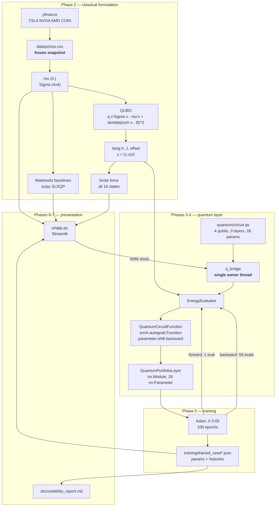

# System Architecture

How the pieces fit together, why the boundaries are where they are, and the
design decisions that were forced by the tools rather than chosen freely.

---

## 1. Overview



Text form, for readers without a Mermaid renderer:

```
yfinance ──> prices.csv (frozen) ──> mu, Sigma ──┬──> QUBO ──> Ising (h, J, offset) ──┐
                                                  │                                    │
                                                  ├──> Markowitz baselines (SLSQP)     │
                                                  └──> brute force, all 16 states      │
                                                                                       v
circuit.qs (4 qubits, 28 params) ──> q_bridge [single owner thread] ──> EnergyEvaluator
                                                                          │
                                    QuantumCircuitFunction (autograd) <───┘
                                                │
                                    QuantumPortfolioLayer (nn.Module)
                                                │
                                    Adam, 100 epochs ──> trained_seed*.json
                                                                │
                                    Streamlit UI  <─────────────┘
                                    (4096-shot readout via q_bridge)
```

---

## 2. Module responsibilities

| Path | Responsibility |
|---|---|
| `quantum/circuit.qs` | Canonical Q# ansatz + sampling operations. Read from disk, never embedded in Python strings. |
| `quantum/test_bridge.qs` | Phase 1 interoperability operations (X gate, control, marshalling). |
| `quantum/q_bridge.py` | **The only module that imports the Q# runtime.** Owns the interpreter thread, both backends, marshalling, bit-order helpers, recycling. |
| `classical/data_pipeline.py` | Fetch/freeze prices, annualise returns and covariance, validate, persist. |
| `classical/hamiltonian.py` | QUBO construction, Ising conversion, encoding/decoding, brute-force enumeration, mapping verification. |
| `classical/markowitz.py` | Continuous baselines (SLSQP, multi-start) and the exhaustive equal-weight baseline. |
| `classical/phase2_gate.py` | Phase 2 validation gate. |
| `training/gradient_bridge.py` | `EnergyEvaluator`, `QuantumCircuitFunction`, `QuantumPortfolioLayer`, Phase 4 gradient gate. |
| `training/optimization.py` | Adam loop, per-epoch logging, persistence, convergence plots. |
| `ui/app.py` | Streamlit interface. Native widgets + Matplotlib only. |
| `tools/verify_threading.py` | Proves the owner-thread design (§4). |
| `tools/capture_ui.py` | Headless Chromium driver: figures + real-Streamlit-path threading proof. |
| `tools/check_reproducibility.py` | Determinism check across pipeline runs. |
| `tools/stability_report.py` | Phase 7 variance analysis → `docs/stability_report.md`. |

**Single point of contact.** No module except `q_bridge` imports `qsharp` or
`qdk`. Everything quantum crosses one boundary, which is what makes the
thread-affinity constraint in §4 enforceable at all.

---

## 3. Phase-by-phase

### Phase 1 — environment and bridge
Verified the installed `qsharp`/`qdk` 1.30.0 API by introspection rather than
recall. Three assumptions were wrong: neither package exposes `__version__`
(use `importlib.metadata`), `import qsharp` is deprecated in favour of `qdk`,
and `StateDump` exposes `as_dense_state()` rather than `as_dict()`. Gate: 10/10,
including an untouched-qubit control (without which a simulator stuck at `One`
would pass the X-gate test) and an exact-vs-sampling cross-check.

### Phase 2 — data and formulation
251 trading days, real market data. Annualised `mu`, `Sigma`; QUBO → Ising with
the mapping verified exhaustively; Markowitz baselines; brute-force ground state.
Gate: 9/9. Found and fixed a **column-ordering bug** where `yfinance`'s
alphabetical column order was zipped against the requested ticker order,
silently attaching each asset's statistics to the wrong name.

### Phase 3 — parametrized circuit
4 qubits, 3 layers of `Ry`/`Rz` + CNOT ladder, plus a trailing `Ry` layer;
28 parameters. Gate: 7/7, including GHZ-state entanglement verification and a
check that **28/28 parameters affect ⟨H⟩** (a trailing `Rz` layer would have been
exactly inert against a diagonal observable — see
[`mathematical_foundations.md`](mathematical_foundations.md) §4).

### Phase 4 — gradient bridge
`torch.autograd.Function` with an exact parameter-shift backward. Gate: max
\|parameter-shift − finite-difference\| **< 1e-9** against a 1e-2 bound (a bound,
not a constant — the finite-difference reference amplifies the backend's
~1.4e-15 nondeterminism by 1/(2ε) = 5e4, so consecutive runs land anywhere in
1e-10…1e-9; see `mathematical_foundations.md` §8), plus
Richardson extrapolation, a sinusoid-fit test of the rule's premise, chain-rule
verification, and `gradcheck`.

### Phase 5 — training
Adam, lr 0.05, 100 epochs, 3 seeds. Seed 42 reaches the true ground state;
seeds 123 and 456 land on the near-degenerate runner-up. Reported as observed.

### Phase 6 — UI
Four sections, `<5 s` load (measured 2.6 s through headless Chromium). Pure
Streamlit + Matplotlib.

### Phase 7 — validation and docs
Stability analysis, reproducibility check, and these documents.

---

## 4. The single-owner-thread interpreter

The most consequential design decision in the system, and it was forced.

### The constraint

The Q# interpreter is a **pyo3 object marked `unsendable`**: it may only be
touched from the thread that constructed it. Violating this does not raise a
Python exception — it triggers a **Rust panic** that kills the calling thread:

```
pyo3_runtime.PanicException: qdk::interpreter::Interpreter is unsendable,
but sent to another thread — left: ThreadId(2), right: ThreadId(1)
```

Streamlit runs **every script rerun on a new ScriptRunner thread**. So an app
that survives its first interaction can panic on the second, and whether it does
depends on thread scheduling — the failure is **intermittent**, which is worse
than a deterministic crash. This was observed live: the UI hung on Section 3
after a second interaction.

### Two rejected alternatives

- **Pass parameters natively instead of interpolating strings.** Would also fix
  the session-growth problem in §5. Not possible: `qsharp.eval("OpName")` returns
  a `GlobalCallable` that Python cannot invoke (`'builtins.GlobalCallable' object
  is not callable`), and a qubit register does not round-trip through Python.
- **Re-`init()` the interpreter on every rerun.** Would work, but costs ~150 ms
  per interaction and leaves the invariant implicit — any future caller that
  forgets is a latent panic.

### The design

All interpreter access funnels through one dedicated worker thread that owns it
for the process lifetime:

```python
def _on_qsharp_thread(fn, *args, **kwargs):
    if _owner_thread_id is not None and threading.get_ident() == _owner_thread_id:
        return fn(*args, **kwargs)          # already the owner: run inline
    return _get_executor().submit(fn, *args, **kwargs).result()   # else marshal
```

**The predicate is thread identity, never worker availability.** The inline
branch is taken **if and only if the caller already *is* the owner thread**. Its
only purpose is to stop nested calls — `probabilities → statevector`,
`_maybe_recycle → reset_runtime` — deadlocking on a pool whose single worker the
caller occupies.

It must never become *"the worker is busy, so run it here"*. That would execute
interpreter code on a foreign thread and reintroduce the panic, and **no
concurrency test would reveal it**, because the results stay numerically correct
right up until the process dies. Contention is handled by *blocking on the
future* — which is what produces the limitation below.

The owner thread's identity is captured from *inside* it
(`executor.submit(threading.get_ident).result()`), not inferred from a thread
name. Interpreter *construction* is routed through the same funnel, so
`get_qsharp()`, `reset_runtime()`, `set_seed()`, `load_qs_source()` and
`eval_qs()` all build and mutate state on the owner thread.

### Known limitation: quantum work is serialized

Every quantum evaluation in the process runs on one thread. Concurrent Streamlit
sessions **do not** execute circuits in parallel — they queue.

Practical impact at current scale: a readout is ~0.6 s, so a handful of
simultaneous users see sub-second queueing and the `<5 s` budget holds
(verified with two concurrent browser contexts interleaving reruns). It would
matter for a genuinely multi-user deployment, and the fix is **process**-level
rather than thread-level parallelism — one interpreter per worker process, e.g.
several Streamlit workers behind a load balancer, or a small pool of subprocesses
each owning its own interpreter. Threads cannot help, by construction.

### Verification

`tools/verify_threading.py` — predicate is identity-based (asserted against the
source), owner thread distinct from caller, nested calls run inline, **recycling
constructs on the owner thread** (13 rebuilds across 40 cross-thread calls, all
returning `-4.8983591648`), 15 sequential fresh threads and 48 concurrent calls
agree, and no Q# object escapes into `st.session_state` or `@st.cache_resource`
(both of which cross rerun boundaries).

`tools/capture_ui.py` — the real Streamlit path: 10 consecutive Run clicks,
`page.reload()` for a fresh session, a second browser context, and interleaved
reruns across both. Identical energy every time, zero
`sent to another thread` panics, zero tracebacks in the server log.

---

## 5. Interpreter recycling

Every `qsharp.eval()` of a **new source string** is compiled into the session and
retained. Because each circuit evaluation interpolates fresh float literals,
every call is a new string, so session state grows without bound and evaluation
cost grows **linearly with the number of prior calls**:

| Evaluations so far | Cost per evaluation |
|---|---|
| 200 | 3.6 ms |
| 1 000 | 15.8 ms |
| 2 400 | 39.9 ms |

Left alone, training cost is **quadratic** in the number of evaluations — a
100-epoch run needs ~5 700 — so a few-second job becomes minutes and keeps
degrading. Native parameter passing would avoid it entirely but is not available
(§4).

The interpreter is therefore torn down and rebuilt every
`MAX_EVALS_BEFORE_RECYCLE = 250` evaluations. A rebuild costs ~100 ms
(`init()` + reloading `circuit.qs`), amortising to well under 1 ms per
evaluation and pinning steady-state cost near the 3.6 ms floor:

| Evaluations so far | Cost per evaluation (with recycling) |
|---|---|
| 200 | 1.8 ms |
| 1 200 | 2.1 ms |
| 2 400 | 2.2 ms |

Flat, and ~18x faster at 2 400 evaluations.

Recycling is invisible to the exact backend, which is deterministic. For the
sampling backend a rebuild would restart the RNG stream, so if a seed was set it
is re-derived as `seed + recycle_count`: reproducible for a given starting seed,
without repeating the same draws after every rebuild.

Recycling and thread ownership touch the same object, so they are tested
**together** (§4, Verification).

---

## 6. Data flow and artifacts

| Artifact | Written by | Consumed by |
|---|---|---|
| `data/prices.csv` | `data_pipeline` (frozen snapshot) | `data_pipeline`, UI price chart |
| `data/statistics.json` | `data_pipeline` | `hamiltonian`, `markowitz`, UI |
| `data/hamiltonian.json` | `phase2_gate` | `gradient_bridge`, `optimization`, UI |
| `data/markowitz_baseline.json` | `markowitz` | UI, stability report |
| `training/trained_seed*.json` | `optimization` | UI, stability report |
| `training/training_summary.json` | `optimization` | stability report |
| `docs/figures/*.png` | `optimization`, `capture_ui`, `stability_report` | docs |
| `logs/*.log`, `logs/*.json` | all phases | post-run review |

`data/prices.csv` is treated as **input, not output**: a fixed historical date
range is not sufficient for reproducibility, because Yahoo does not return
byte-identical data for one (see
[`mathematical_foundations.md`](mathematical_foundations.md) §11).
`statistics.json` records the snapshot's SHA-256 so a changed input is
detectable rather than invisible.

---

## 7. Validation gates

Each phase has an executable gate; none advanced until its gate passed.

| Gate | Command | Headline result |
|---|---|---|
| Phase 1 | `python quantum/q_bridge.py` | 10/10 |
| Phase 3 | `python quantum/q_bridge.py --test-circuit` | 7/7 |
| Phase 2 | `python classical/phase2_gate.py` | 9/9 |
| Phase 4 | `python training/gradient_bridge.py` | gradient agreement < 1e-9 |
| Threading | `python tools/verify_threading.py` | 13/13 |
| Reproducibility | `python tools/check_reproducibility.py` | deterministic |
| UI | `python tools/capture_ui.py` | 10/10, cold start 2.6 s |

Gates assert **properties**, not golden outputs: exhaustive identities over all
16 basis states, independent reimplementations cross-checked against each other,
and controls that would fail if a component were trivially broken.

---

## 8. Deviations from the original specification

Recorded rather than silently absorbed.

1. **`tools/` directory added.** Not in the specified layout. Holds the four
   verification/capture scripts, which are development utilities rather than
   pipeline stages.
2. **Full `README.md` at the repository root**, with `docs/README.md` as a
   documentation index. The spec placed the README under `docs/`; a repository
   whose root has no README is unhelpful to anyone cloning it, and duplicating
   the content in both places would guarantee drift.
3. **Exact state-vector backend added alongside sampling.** The spec's Phase 4
   tolerance of ~1e-2 is unreachable by sampling at any practical shot count
   (~5.6M shots per gradient step). Both backends exist and are cross-validated;
   sampling still drives the Phase 6 readout.
4. **Ansatz ends on `Ry`, not `Rz`.** A trailing `Rz` layer is exactly inert
   against a diagonal observable, wasting 4 of 28 parameters on identically-zero
   gradients.
5. **`plotly` pinned but unused.** The spec allowed `st.plotly_chart` *or*
   `st.pyplot`; Matplotlib was chosen throughout for consistency with the
   offline figures. The dependency is retained because the spec lists it.
6. **Phase 5 ran all three seeds** rather than deferring two to Phase 7, at the
   user's direction, so Phase 7 analyses existing data.

---

## 9. Notes on two resolved defects

### Streamlit dataframe sorting

Section 1's table originally stored pre-formatted **strings** (`"+43.64%"`),
which Arrow types as `large_string`, so header-click sorting could not order the
column numerically. Columns are now numeric (`double`) with presentation handled
by `st.column_config.NumberColumn`, and ascending sort gives
COIN → NVDA → TSLA → AMD as expected.

**The mechanism, settled by direct experiment.** A standalone Streamlit page was
built rendering the original string-column table in both candidate formats, and
driven with Playwright, clicking the `Annual return` header and screenshotting
the result. Outcome:

| Format | Click 1 (↑) | Click 2 (↓) |
|---|---|---|
| `"{:+.2%}"` (as shipped) | COIN, AMD, NVDA, TSLA | TSLA, NVDA, AMD, COIN |
| `"{:.2%}"` (no plus) | COIN, AMD, NVDA, TSLA | TSLA, NVDA, AMD, COIN |

Both formats behave **identically**, so the string content is irrelevant — no
lexicographic comparison is taking place. Click 1 yields the exact reverse of the
original row order; click 2 yields the original row order. The mechanism is
therefore:

> On a string column the grid's comparator does not order the values (it returns
> 0 for every pair). "Descending" leaves the stable sort untouched, giving the
> original row order; "ascending" reverses it. Neither direction reflects the
> data, and the ↑/↓ indicator is meaningless here.

That reproduces the original observation exactly, including the detail that the
`+` signs were visibly rendering on screen at the time.

**A retracted claim.** An earlier revision of this section asserted that
ascending lexicographic ordering of percent strings *without* a leading `+` was
the "unique match", having tested every combination of column, format, and
direction. That was a claim about a **restricted search space** presented as a
global one: the stable-sort-then-reverse mechanism lies outside the
column × format × direction family, so that search could not have found it. The
apparent lexicographic match was coincidence — `"-60.91%"` sorts below the digits
*and* COIN happens to be the last row, so reversal and lexicographic ordering
produce the same sequence for that one format. The experiment above distinguishes
them; lexicographic ordering is refuted.

The fix is correct independently of the mechanism: numeric columns sort
numerically, verified via the Arrow schema (`double`, not `large_string`).

### Variable shadowing in the UI

A shot-noise standard deviation was briefly named `sigma` in `main()`,
shadowing the covariance matrix that the `metrics()` closure reads, and Section 3
died with `matmul: operand 1 has 0 dimensions`. Renamed to `shot_sigma`. Only
running the app surfaced it — no unit test covered the closure's captured scope.
