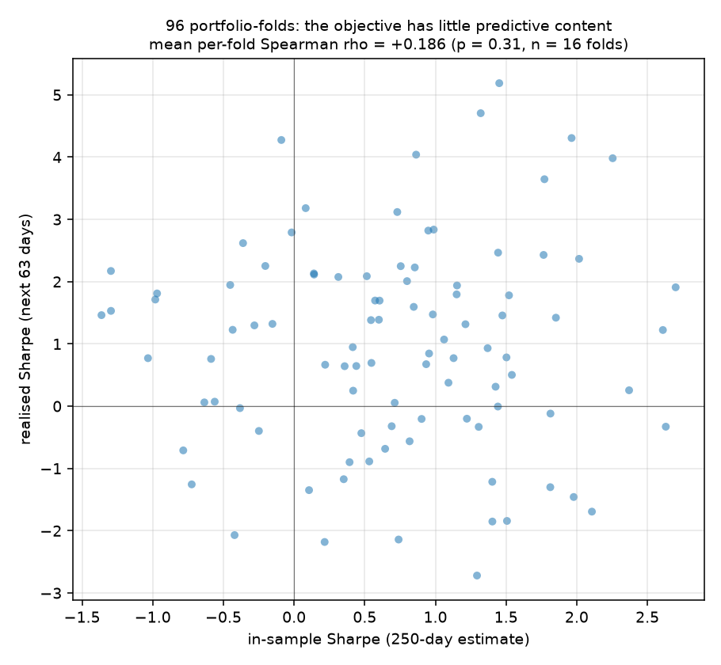
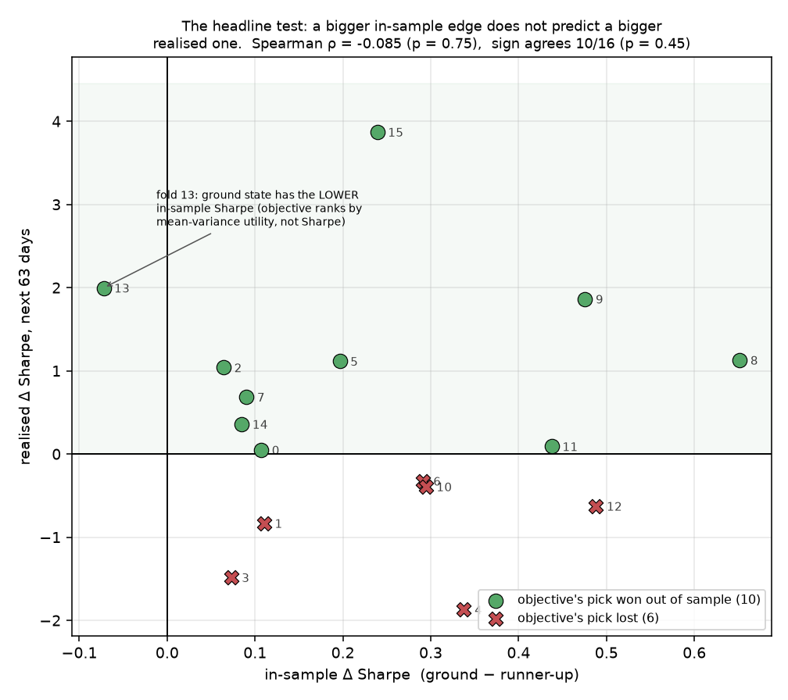
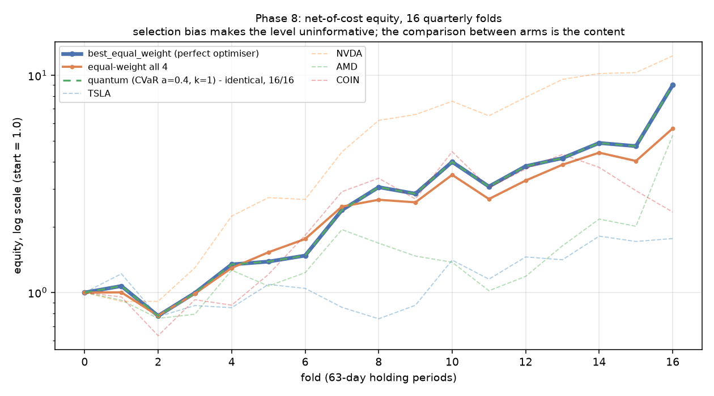
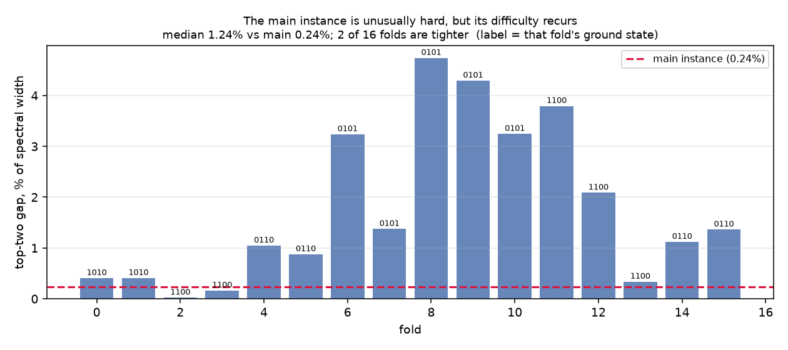

# Out-of-Sample Backtest: Is the Minimum Worth Finding?

**A backtest does not test the optimiser. It tests the objective.** VQE's job is
to minimise a *given* Hamiltonian, and Phases 4–9 establish that it does: exact
gradients, a validated CVaR identity, and a measured readout accuracy. Whether
the minimiser of that Hamiltonian is a good *investment* is a separate question
about mean–variance selection estimated on 250 days of history. Every result
below is evidence about **that** question. A weak result here is evidence against
in-sample mean–variance selection on four volatile technology stocks; it is
**not** evidence against the quantum method, and no sentence in this document
should be read that way.

The separation matters because the two are easy to conflate. Phase 7 measured
plain VQE missing the `1010` vs `0110` discrimination **33% of the time** and
treated that as the project's central weakness. This phase asks the prior
question: **is that discrimination worth making at all?**

---

## 0. Sample size and dependence, stated before any result

**16 folds.** That is small, and it is the binding constraint on everything
here. Five years of history divided into non-overlapping quarters does not
produce more.

**The dependence structure is asymmetric, and the distinction matters for which
tests are trustworthy.** Consecutive folds share **187 of their 250** estimation
days — about 75% — so the *decisions* are strongly correlated: fold 7 tends to
select what fold 6 selected because they were estimated on largely the same
data. But the holding periods are **non-overlapping by construction** (63-day
step, 63-day holding), so each fold's *outcome* is realised on a disjoint stretch
of returns.

> **Correlated decisions, independent outcomes.** Every binomial and
> Clopper–Pearson interval in §4 is therefore sound as stated — each trial's
> result is driven by its own non-overlapping return window. What the overlap
> does limit is the *diversity* of the decisions being tested: sixteen folds do
> not supply sixteen independent portfolio choices, so a run of folds selecting
> the same pair is really one decision tested on several independent periods.

Section 8 states in advance what this design can and cannot detect; the short
version is that it is powered to detect effects roughly **four times larger**
than the one it is looking for, so *"indistinguishable"* is the expected outcome
rather than a disappointing one.

---

## 1. The question, made specific

On the frozen main instance:

| | in-sample Sharpe |
|---|---|
| `1010` (TSLA + AMD) — ground state | **2.159893** |
| `0110` (NVDA + AMD) — runner-up | 2.128973 |
| difference | **+0.030920 (+1.45%)** |

That 1.45% is the entire prize. Resolving it is what the 0.039209 energy gap —
0.24% of the spectral width — encodes, and what Phase 9 showed is hard enough
that plain VQE gets it wrong a third of the time.

> **If the in-sample winner wins out of sample only about half the time, then the
> optimiser's error rate costs nothing in reality — it was resolving noise.**

---

## 2. Design

| | |
|---|---|
| data | `data/backtest_prices.csv`, **a separate frozen snapshot** |
| SHA-256 | `17e87c2f6bfcb320952d677422ded4670d6a835c6fadd115e9e811082264c746` |
| window | 2021-06-01 → 2026-06-30, **1276 trading days** |
| why 2021-06 | COIN listed 2021-04-14; no earlier start exists for this basket |
| estimation | rolling **250 days** (matches the main instance) |
| holding | **63 days**, stepping 63 → non-overlapping quarters |
| folds | **16** |
| per fold | estimate µ, Σ → build that fold's own Ising Hamiltonian → enumerate all 6 feasible 2-asset portfolios → measure realised return over the next 63 days |
| quantum arm | CVaR **α = 0.4**, **k = 1**, 200 epochs, seed 42 — 16 runs, not 80 |
| costs | 10 bps per side on quarterly rebalancing |
| conventions | 252-day annualisation, simple returns, rf = 5%, q = 1.0, B = 2 — all inherited unchanged from Phase 2 |

`data/prices.csv` was **not** re-fetched, read for estimation, or modified;
its SHA-256 is identical before and after this phase (invariant 1).

The quantum arm runs at k = 1 because Phase 9 measured CVaR α = 0.4 at 30/30
single-shot. That is an assumption transferring a result to Hamiltonians it was
never tuned against, so §6 checks it rather than presuming it.

---

## 3. Does the objective predict anything?

**No — not detectably, at this sample size.**

| metric | value | 95% CI | p |
|---|---|---|---|
| per-fold Spearman ρ(in-sample Sharpe, realised Sharpe) across all 6 portfolios | **+0.186** | [−0.191, +0.563] | 0.310 |
| folds with ρ > 0 | 10 / 16 | | |
| in-sample top is also realised top | **4 / 16 = 25.0%** | [7.3%, 52.4%] | 0.325 vs 16.7% chance |



Ninety-six portfolio-folds. The relationship is weakly positive and cannot be
distinguished from zero. The point estimate is *not* zero, and with more folds it
might separate — but nothing here licenses the claim that it does.

---

## 4. The discrimination the optimiser is asked to make

This is the sharp test. For each fold, take the two lowest-energy states — the
pair VQE must tell apart — and ask whether the in-sample winner also won out of
sample. There are two ways to ask it, and **they point in opposite directions.**

| test | result | 95% CI | p vs coin flip |
|---|---|---|---|
| **Generalised:** each fold's own ground state beats its own runner-up | **10 / 16 = 62.5%** | [35.4%, 84.8%] | 0.454 |
| **Specific:** `1010` (TSLA+AMD) beats `0110` (NVDA+AMD) | **6 / 16 = 37.5%** | [15.2%, 64.6%] | 0.454 |

The generalised test mildly *favours* the objective; the specific test mildly
*opposes* it. Both intervals contain 50% comfortably, both p-values are 0.454,
and the two disagree in sign.

> **The shared conclusion is the finding: neither is separable from chance.**
> Reported side by side deliberately. A reader shown only the 6–10 record would
> conclude the objective is *anti*-predictive, and the generalised test does not
> support that. A reader shown only the 10–6 record would conclude it works.
> Neither conclusion survives its own confidence interval.

The magnitude tells the same story. **All three rows below refer to the
generalised Δ** — each fold's own ground state minus its own runner-up — which is
also the pair the Spearman correlation is computed on:

| generalised Δ (ground − runner-up) | |
|---|---|
| mean Δ Sharpe, in-sample | +0.2418 (positive in **15 of 16** folds, not 16 †) |
| mean Δ Sharpe, realised | +0.4168 (sd 1.436, p = 0.264) |
| **Spearman(Δ in-sample, Δ realised)** | **−0.085 (p = 0.753)** |

> † **Not positive by construction, as one might expect.** The Hamiltonian orders
> states by the penalised **mean–variance objective**, not by Sharpe ratio. The
> two orderings agree in 15 of 16 folds but not in fold 13, where the ground
> state `1100` has a *lower* in-sample Sharpe than the runner-up `0101`
> (Δ = −0.0724). Anywhere this document says the optimiser selects the
> "in-sample winner", that means the argmin of the objective it was given — which
> is not quite the same portfolio as the in-sample Sharpe maximiser.

**Lean on the sign test, not the mean.** Realised Δ averages +0.4168 with a
standard deviation of **1.436** — over three times the mean — so a single
outlying fold can carry the whole average, and one does: dropping fold 15
(Δ = +3.87) moves the mean to **+0.1866**, less than half. The 10/16 sign test is
robust to exactly that; the mean is not. Where the two appear to disagree — a
positive mean beside a coin-flip sign test — **the sign test is the one to
believe.**



Each point is one fold. The horizontal axis is how much the objective preferred
its pick; the vertical axis is what that pick actually earned. **A predictive
objective would put the points on a rising line.** They are scattered, and the
one fold left of zero (13) is the case noted above where the objective's pick has
the *lower* in-sample Sharpe — yet won anyway.

**The Spearman row is the cleanest single number in this document — because it is
near zero, not because it is negative.** With p = 0.753 the sign carries no
information whatsoever, and nothing here should be read as the in-sample edge
being *inversely* related to the realised one. The claim is the weaker and more
defensible one: **the size of the in-sample edge tells you nothing about the
realised edge.** A fold where the Hamiltonian strongly prefers one portfolio is
not a fold where that portfolio subsequently does better — nor one where it does
worse.

### What one optimiser error would have cost

Choosing the runner-up instead of the ground state — exactly the error Phase 7
measured at 33% — is worth, in realised quarterly total return:

| | |
|---|---|
| mean | **+7.42%** |
| median | +2.83% |
| 95% CI | **[−6.02%, +20.86%]** |
| p | 0.258 |
| folds where the ground state paid more | 11 / 16 |

The interval comfortably straddles zero. **An optimiser error is not measurably
expensive on this data.**

---

## 5. The decomposition

Three comparisons, deliberately ordered so the optimiser and the objective
cannot be confused. `best_equal_weight` is a **perfect optimiser**: it selects
each fold's exact in-sample argmin by brute-force enumeration over 16 states.

| comparison | isolates | mean per-fold return diff | p | folds positive |
|---|---|---|---|---|
| quantum − `best_equal_weight` | **optimiser error** | **identical on all 16 folds** | — | — |
| `best_equal_weight` − equal-weight-4 | **value of the objective** | +4.90% | 0.219 | 10 / 16 |
| `best_equal_weight` − `buy_hold_NVDA` | context | −1.07% | 0.867 | 6 / 16 |

**The first row is exactly zero, not approximately zero.** The quantum arm
selected the same portfolio as brute-force enumeration on every one of the 16
folds, so the two equity curves coincide to the last decimal.

> **This means the backtest contains _no information_ about the quantum arm's
> economic value — in either direction.** A comparison with zero variance is not
> a measurement of zero effect; it is the absence of a measurement. The design
> cannot separate the two arms because they never differed. Nobody should read
> "quantum matched classical exactly" as a performance claim, favourable or
> otherwise: it is a statement that this experiment had nothing to compare.

The cost of a *hypothetical* error is bounded separately in §4, and that bound
also contains zero — but that is a property of the objective, established from
the classical folds, not a measurement of the optimiser.

**The quantum arm's actual contribution to this phase is a robustness check on
Phase 9, not a backtest result. See §6.**

The second row is the real content, and it is **not** significant at n = 16
(p = 0.219), though 10 of 16 folds favour it and the sign is consistent.



| arm | total | CAGR | vol | Sharpe |
|---|---|---|---|---|
| `buy_hold_NVDA` | **+1127.3%** | +87.2% | 50.6% | **+1.393** |
| `best_equal_weight` (perfect optimiser) | +800.3% | +73.2% | 51.3% | +1.233 |
| **`quantum_cvar040`** | **+800.3%** | **+73.2%** | **51.3%** | **+1.233** |
| equal-weight all 4 | +468.8% | +54.4% | 48.9% | +1.031 |
| `buy_hold_AMD` | +429.3% | +51.7% | 55.3% | +0.936 |
| `buy_hold_COIN` | +134.7% | +23.8% | 87.3% | +0.615 |
| `buy_hold_TSLA` | +77.2% | +15.4% | 58.9% | +0.451 |

**A perfect optimiser lost to holding one stock.** `buy_hold_NVDA` beats every
optimised arm on both total return and Sharpe. This is selection bias in its
starkest form — §8 — and it is reported here rather than buried because it is
the single most important qualifier on the table above.

> **Convention.** Total return and CAGR are net of transaction costs; the Sharpe
> column is computed from the daily series, which is gross of them. Total costs
> range from 10 bps (`buy_hold_*`) to 73 bps (`best_equal_weight`) over the whole
> period, so the distinction does not affect any ordering.

---

## 6. External validation of Phase 9 — not a backtest result

**This section is the quantum arm's real contribution to Phase 8, and it belongs
to Phase 9's question, not this document's.** The backtest could not measure the
optimiser's economic value (§5). What it *could* do — for free, as a by-product
of needing a portfolio choice each fold — is put Phase 9's configuration in front
of **16 Hamiltonians it was never tuned against**.

| | |
|---|---|
| matched the fold's exact in-sample argmin | **16 / 16 = 100%** |
| 95% CI (Clopper–Pearson) | [79.4%, 100%] |
| infeasible readouts | **0** |
| mean P(ground state) | **0.4988** |
| lowest P(ground state) in any fold | **0.4169** |

Phase 9's α = 0.4 configuration transferred at k = 1 with no failures and no
budget violations. As in Phase 9 this is a point estimate: the interval admits a
true rate near 80%, and 16 trials cannot show more.

**The plurality mechanism reproduced.** Phase 9's central mechanistic finding was
that the argmax guarantee never binds — P(ground) ≥ 0.5 is sufficient but not
necessary, because a *plurality* suffices and CVaR fragments the losing mass
across the remaining states. Mean P(ground) here is **0.4988**, *below* the 0.5
threshold that would guarantee a correct readout, with individual folds down to
**0.4169** — and every one read out correctly regardless.

That is independent confirmation on new problem instances, and it is the
strongest external evidence the project has for §5 of
[`objective_comparison.md`](objective_comparison.md). It is a **robustness check
on Phase 9**, and should be cited as one — not as evidence that the quantum
method performs well economically, which §5 explains this design cannot address.

---

## 7. The main instance is doubly atypical

Every fold has a different Hamiltonian, so 16 independent draws of "what does
this problem look like?" come free. **The instance the entire project is built on
is unusual in two separate ways**, and they cut in opposite directions.

### Atypical (1): an uncommon ground state

| ground state | folds |
|---|---|
| `0101` (NVDA + COIN) | 5 |
| `1100` (TSLA + NVDA) | 5 |
| `0110` (NVDA + AMD) | 4 |
| **`1010` (TSLA + AMD)** — the project's answer | **2** |

The project's `1010` wins only **2 of 16** windows, tied for least common. It is
a property of the 2025–26 estimation window, **not of this basket**.

### Atypical (2): an unusually tight gap



| | gap as % of spectral width |
|---|---|
| **main instance (Phases 1–9)** | **0.2368%** |
| fold median | 1.24% |
| fold minimum | **0.0228%** (fold 2) |
| fold maximum | 4.74% (fold 8) |
| folds tighter than the main instance | **2 of 16** (folds 2 and 3) |

The median fold's gap is **five times wider**. Only folds 2 (0.0228%) and 3
(0.1630%) are tighter — but fold 2 is tighter by an order of magnitude, so
near-degeneracy is a real recurring feature and not a quirk of one chosen year.

### Why this cuts both ways

**In favour of the optimiser results.** Phases 5–9 — the 60% baseline, the 66.7%
improvement, the climb to 100% under CVaR α = 0.4 — were all measured on a
**harder-than-typical instance**. The median fold offers five times the energy
separation to discriminate against. Whatever those accuracy figures are worth,
they were not obtained on an easy case, and a typical window would likely be
*more* forgiving.

**Against the specific answer.** The TSLA+AMD result, the 1.45% Sharpe edge, and
the `1010`-vs-`0110` pairing that Phases 7 and 9 are organised around are all
properties of **one year**, not of this basket. Two-thirds of the windows are
fought over an entirely different pair. This sharpens §4: the discrimination VQE
is asked to make is **re-drawn every quarter**, and the specific contest the
project treats as canonical appears in only 2 of 16 of them.

### Does this narrow the headline result? — tested, and no

There is a tempting argument here, and it does not survive contact with the data.

**The argument:** §4 found the in-sample edge unpredictable, and §7 shows that
edge was measured on one of the *tightest* gaps in the sample — where the two
portfolios are most nearly equivalent and unpredictability is least surprising.
On a fold with a 4.74% gap the two portfolios differ substantially, so the
objective might well separate them. If so, §4's conclusion would be about
**near-degenerate discriminations specifically**, not about mean–variance
selection in general — a considerably narrower claim.

**The test.** Split the 16 folds at the median gap (1.2416%) and compare the
generalised win rate in each half:

| half | gap range | ground beats runner-up | 95% CI | mean Δ realised Sharpe |
|---|---|---|---|---|
| **tight** | 0.02% – 1.12% | **5 / 8 = 62.5%** | [24.5%, 91.5%] | +0.046 |
| **loose** | 1.36% – 4.74% | **5 / 8 = 62.5%** | [24.5%, 91.5%] | +0.787 |

Fisher exact **p = 1.000**. Spearman(gap, win) = **+0.028** (p = 0.918).

**The win rate is identical in both halves.** On the sign test — the measure §4
establishes as the trustworthy one — a wide gap predicts the outcome no better
than a tight one. The mean Δ *is* larger in the loose half, weakly consistent
with the argument, but that is precisely the outlier-driven statistic §4 warns
against, and Spearman(gap, Δ realised) is only +0.156 (p = 0.564).

> **So the narrowing is not supported.** At n = 8 per half this resolves nothing
> statistically — but it certainly does not point the way the argument needs, and
> reporting it as though it did would be picking the more flattering of two
> measures. The honest position: **§4's conclusion is stated at the scope the
> data supports — this basket, this horizon — and whether it narrows to
> near-degenerate cases specifically is an open question this design leaves
> open.**

### What it does not settle

This speaks to the open question in
[`objective_comparison.md`](objective_comparison.md) §8 only partially. It shows
the gap varies by **two orders of magnitude across instances of the same size**.
It says nothing about the n-dependence that section actually asks about, which
still requires 6- and 8-asset runs.

---

## 8. Limitations

Stated in advance, in descending order of how much they should change your
reading.

**Selection bias is the largest, and it is not fixable.** TSLA, NVDA, AMD, and
COIN were chosen in 2026 with full knowledge of how they turned out. No investor
in June 2021 picks this basket. Every absolute return in §5 is inflated by an
unknowable amount, and the fact that `buy_hold_NVDA` beats every optimised arm is
the visible symptom: the basket was chosen partly *because* NVDA did what it did.
**Only the between-arm comparisons carry information, and even those are
conditioned on a universe selected after the fact.**

**Power is very low, and this was predicted rather than discovered.**

| test | observed | 80%-power MDE at n = 16 | ratio |
|---|---|---|---|
| Δ Sharpe, ground vs runner-up | +0.417 | **1.076** | 2.6× short |
| in-sample Sharpe edge being tested | 0.242 | 1.076 | **4.4× short** |
| objective value (return diff) | +4.90% | 11.47% | 2.3× short |
| vs best single asset | −1.07% | 18.82% | 17.6× short |

The design cannot detect the effect it is looking for. Detecting a Sharpe
difference of 0.242 at 80% power would need **279 quarterly folds — about 70
years**. This is a structural property of quarterly rebalancing on five years
of data, which is why *"indistinguishable"* was stated as the expected result in
§0 rather than offered afterwards as an excuse.

**The decisions are correlated; the outcomes are not.** See §0 — this is the more
precise statement of a caveat that is easy to overstate. Consecutive folds share
**187 of 250** estimation days, so which portfolio gets selected is strongly
correlated across folds. But holding periods are **non-overlapping**, so each
outcome is realised on a disjoint stretch of returns. The binomial intervals in
§4 are therefore **not** inflated by overlap. What the overlap costs is the
diversity of decisions tested: 16 folds do not provide 16 independent portfolio
choices, and a run of folds selecting the same pair (folds 6–10 all choose
`0101`) is closer to one decision tested on five independent periods.

**Point-in-time contamination.** Prices are adjusted closes as of the fetch date,
so they embed split and dividend factors not knowable during the window.
Acceptable for a total-return study, but worth flagging given the vendor
adjustment drift already measured in this project (invariant 1: NVDA's annualised
mean moved 1.0e-9 between two consecutive fetches of the *same* historical
window). The direction of any resulting bias is not established.

**Transaction costs are a flat 10 bps per side** on `sum |Δw|`, with no spread,
market impact, or slippage model. At quarterly rebalancing the totals are small
(≤ 73 bps over five years), so this assumption is not load-bearing.

**One basket, one horizon, one risk aversion.** q = 1.0, B = 2, 63-day holding.
Nothing here establishes that the conclusions survive a different budget, a
different rebalancing frequency, or assets with different return characteristics.

**In-sample statistics inside each fold.** µ and Σ are estimated on the training
window with no shrinkage, no factor model, and no regularisation — the same
plain sample estimators used throughout the project. Shrinkage is the standard
remedy for exactly the noise this document measures, and a Ledoit–Wolf arm would
be the natural next experiment.

---

## 9. What this does and does not establish

**Establishes:**

- On this data, the in-sample edge between the two best portfolios cannot be
  distinguished from chance out of sample. **Two ways of asking disagree in
  direction** — 10/16 generalised, 6/16 on the specific pair — and both have
  p = 0.454 with intervals straddling 50%.
- The *magnitude* of the in-sample edge carries no predictive information
  (ρ = −0.085, p = 0.753 — near zero, not meaningfully negative).
- Phase 9's plurality mechanism reproduces on unseen Hamiltonians: mean
  P(ground) = 0.4988, below the guarantee threshold, with 16/16 correct readouts
  and 0 infeasible.
- Near-degeneracy recurs across windows, and **the main instance is doubly
  atypical** — an uncommon ground state (2 of 16 windows) with an unusually tight
  gap (median 5× wider).

**Does not establish:**

- That the objective has *no* predictive content. The point estimates are
  positive; the study is simply too small to resolve them, and
  "indistinguishable from chance" is not "zero".
- **Anything about the quantum arm's economic value.** It matched the perfect
  optimiser on every fold, so the comparison has zero variance — the absence of a
  measurement, not a measurement of no effect.
- That optimiser accuracy is worthless in general. It is worth little **on this
  instance family, at this horizon**, because the quantity being resolved is
  itself unstable.
- **That the result narrows to near-degenerate discriminations.** The obvious
  narrowing — "this only shows tight gaps are unpredictable" — was tested by
  splitting at the median gap and is **not supported**: 5/8 in both halves,
  Fisher p = 1.000 (§7). At n = 8 per half that settles nothing either way, so
  the scope stays where the data puts it.
- Anything about VQE's correctness. That is Phases 4–9, and this document is
  not evidence for or against it.

**The closing result.** Phase 7 treated a 33% readout error rate as the project's
central weakness, and Phase 9 spent an entire objective study reducing it. This
phase finds that the discrimination being fought over — worth 1.45% of in-sample
Sharpe — is **not measurably worth anything out of sample**. The engineering was
sound and the optimiser works; the *objective* it was pointed at is where the
value question actually lives. That is a result about mean–variance portfolio
selection, and it leaves everything Phases 1–9 measured about the quantum method
intact.

---

## 10. Reproducing

```bash
python backtest/fetch_snapshot.py
```

```bash
python backtest/run_backtest.py
```

```bash
python backtest/analyse.py
```

`fetch_snapshot.py` verifies the committed SHA-256 and refuses to proceed if the
snapshot has changed. `--refresh` re-fetches and **invalidates every number in
this document**; yfinance does not return byte-identical data for a fixed
historical window.
