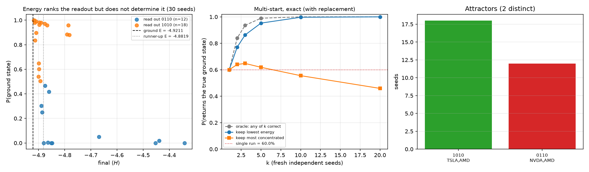
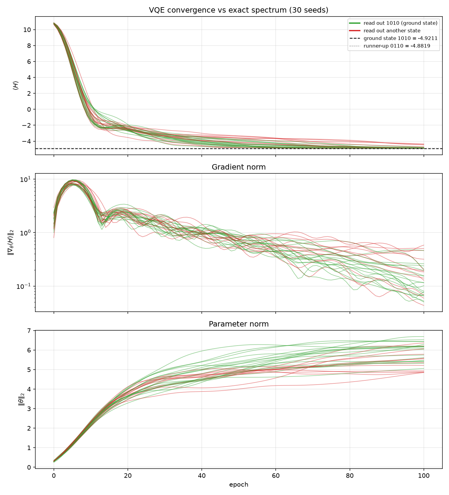

# Stability Validation Report

Phase 7 reproducibility analysis over **30 random initialisations**. Generated by `tools/stability_report.py`.

## Headline

Every run was identical except for its random seed. Three numbers, not one, because the runs are **two distinct populations** and a single average hides that:

- **60.0% overall** — the true ground state was returned in 18 of 30 runs (Wilson 95% **[42.3%, 75.4%]**).
- **65.2% among the 23 runs that converged** to within 0.5% of the ground energy (Wilson 95% [44.9%, 81.2%]). These optimised successfully and then lost a 0.24% discrimination between the two lowest states. **This is the near-degeneracy finding.**
- **7 runs never optimised at all**, finishing far above the ground energy for reasons unrelated to the degeneracy. They are ordinary optimiser failure — a separate open question about initialisation and step size — and they account for almost all of the headline energy spread.

The two groups are separated by an empty band in the data, so the split is not an artifact of where the threshold was drawn (see below).

The pipeline is bit-for-bit reproducible; the *optimiser* is not reliably correct. Those are separate findings and both hold.

## Scope: these are in-sample results

Stated plainly because it bounds every number here.

Expected returns and the covariance matrix are estimated from the **same 250 trading days** (2025-07-01 to 2026-06-30) that the resulting portfolios are then scored on. There is no train/test split and no walk-forward validation. A single one-year window also provides essentially **one observation** of each asset's annualised mean return, so `mu` carries enormous estimation error that no figure in this report attempts to quantify.

What this report therefore does and does not claim:

- **Claimed:** optimiser reliability against a *known ground truth* on a realistic problem instance. Because the Hamiltonian is diagonal with 16 enumerable eigenvalues, "did the optimiser find the minimum?" has an exact answer, and that question is entirely independent of whether the minimum is a good investment.
- **Not claimed:** that these portfolios are good investments, that the reported Sharpe ratios are achievable out of sample, or that the asset ranking would survive a different window. In-sample mean-variance optimisation is well known to overfit; the 100%-AMD max-Sharpe corner solution is a textbook symptom of exactly that.

The optimisation target is a *fixed, fully specified* mathematical object. Whether that object is the right one to optimise is a finance question this project does not address.

## Method

30 runs, identical in every respect except the random seed: same frozen price snapshot (`data/prices.csv`, SHA-256 recorded in `data/statistics.json`), same Hamiltonian, 100 epochs, Adam at lr = 0.05, 3 ansatz layers, 28 parameters, exact state-vector backend.

- Exact ground state: **1010** (TSLA, AMD), E = **-4.921119**
- Nearest competitor: **0110** (NVDA, AMD), E = **-4.881910**
- Degeneracy gap: **0.039209**, against a spectral width of 16.5608 — **0.24%**

## Aggregate results

| Quantity | Value |
|---|---|
| Runs | 30 |
| Reached the ground state | 18 (60.0%) |
| Wilson 95% interval | [42.3%, 75.4%] |
| Distinct attractors | 2 |
| Final ⟨H⟩ mean | -4.824163 |
| Final ⟨H⟩ std (population) | 0.147857 |
| Final ⟨H⟩ spread | 0.576763 |
| Energy spread ÷ degeneracy gap | **14.71×** |
| Sharpe mean | +2.1475 |
| Sharpe spread | 0.0309 |

**Run-to-run energy variation is 14.71× the degeneracy gap the optimiser has to resolve.** The spread of outcomes is an order of magnitude wider than the difference it is being asked to detect, which is why any single run is unreliable.

That ratio does **not**, however, mean the energy is uninformative, and the distinction matters for how the method should be used:

- The **13 lowest-energy runs of 30 are all correct**. The first incorrect run appears only at rank 14.
- The two groups do **overlap** in energy: correct runs span [-4.918784, -4.781960], incorrect runs [-4.889409, -4.342022], and 5 correct runs finish at a *higher* energy than the best incorrect one. So energy does not **determine** the readout — but the overlap lies in the poor-energy region, which a keep-the-minimum rule never selects from.
- The globally lowest-energy run **is** correct (seed 1013, ⟨H⟩ = -4.918784, P(ground state) = 0.9988).

P(ground state) is deliberately *not* summarised by a standard deviation. Its distribution is strongly bimodal — runs either place substantial amplitude on the ground state or almost none — so a single spread statistic would describe nothing real. The attractor table below is the meaningful summary.

### Two distinct failure modes, separated

The incorrect runs are **not one population**. Splitting them at 0.5% of the spectral width above the ground energy (⟨H⟩ ≤ -4.838315) isolates two unrelated behaviours:

| Group | Runs | Correct | Accuracy | ⟨H⟩ range | Spread ÷ gap |
|---|---|---|---|---|---|
| **Converged** (within 0.5% of ground) | 23 | 15 | **65.2%** | [-4.918784, -4.848732] | 1.79× |
| **Failed to optimise** | 7 | 3 | 42.9% | [-4.791393, -4.342022] | 11.46× |

**The split does not depend on where the cut was placed.** The worst converged run finishes at -4.848732 and the best failed run at -4.791393, so the threshold (-4.838315) falls inside an **empty band 0.057339 wide** — 1.46× the degeneracy gap itself, with no run anywhere in it. Any cut in that interval produces exactly the same partition. The two groups are genuinely disjoint populations rather than two ends of one continuum, which is what justifies analysing them separately; the 0.5% figure merely names a point inside the gap.

This is the most important structural fact in the sweep, and merging the two groups obscured it:

- **The 14.71× overall energy spread is almost entirely the second group.** Within the converged subset the spread is only **1.79× the degeneracy gap** — the same order as the gap itself, which is the regime the near-degeneracy finding actually lives in.
- **The near-degeneracy result is the converged subset.** Those runs optimised successfully and then lost a 0.24% discrimination: accuracy 65.2% (Wilson 95% [44.9%, 81.2%]) on 23 runs.
- **The remaining 7 runs are ordinary optimiser failure**, not a degeneracy problem — they finished 0.579 to 0.130 above the ground energy, far outside the 0.039 gap, and would be discarded by any selection rule. Diagnosing them is a separate question about initialisation and step size.

### Attractors

| Readout | Assets | Seeds | Share | Ising energy | Sharpe |
|---|---|---|---|---|---|
| `1010` **(ground state)** | TSLA,AMD | 18 | 60.0% | -4.921119 | +2.1599 |
| `0110` | NVDA,AMD | 12 | 40.0% | -4.881910 | +2.1290 |

All 2 attractors are **feasible** portfolios — every run landed in the constrained subspace, so the budget penalty is doing its job even where the optimiser picks the wrong basket.

## Multi-start selection, measured

All figures below are **exact closed-form** probabilities, not bootstrap estimates. An earlier draft used 20 000 Monte Carlo draws, which added sampling noise of its own (k = 1 came out 60.2% against a true 60.0%) and rounded small failure probabilities away entirely — the regime that matters most at large k.

Two selection rules are compared, each just an ordering of the runs:

- **keep lowest energy** — prefer the run with the smallest final ⟨H⟩.
- **keep most concentrated** — prefer the run whose measured distribution is most concentrated on one basis state (largest P(readout)). This needs no knowledge of the true ground energy.

**oracle** is "at least one drawn run was correct" — the ceiling no ranking rule can exceed.

### Predictive: run k fresh seeds (with replacement)

This is the model behind any "just run k seeds" recommendation — k new independent runs, treating the 30 observed as the population. It never saturates, so it is the table the practical claim rests on.

| k | keep lowest energy | keep most concentrated | oracle | energy-rule shortfall |
|---|---|---|---|---|
| 1 | 60.00% | 60.00% | 60.00% | +0.00% |
| 2 | 77.11% | 64.00% | 84.00% | +6.89% |
| 3 | 86.33% | 64.78% | 93.60% | +7.27% |
| 5 | 95.27% | 61.86% | 98.98% | +3.71% |
| 10 | 99.69% | 55.54% | 99.99% | +0.30% |
| 20 | 100.00% | 45.91% | 100.00% | +0.00% |

### Descriptive: pick k of the 30 runs already in hand (without replacement)

A statement about **this pool**, not about the method: both columns are forced to 100% once the pool can no longer supply a failing subset. The two thresholds are different and neither is a property of the optimiser.

- **Oracle** fails only if *every* drawn run is incorrect. There are 12 incorrect runs, so an all-incorrect subset exists for k ≤ 12; the oracle is forced to exactly 100% only at **k ≥ 13**.
- **Keep lowest energy** fails only if the subset avoids the entire leading block of correct runs — energy ranks 1–13, which are all correct. Avoiding them means drawing from the remaining 17 runs, possible for k ≤ 17; it is forced at **k ≥ 18**.

So the 100% entries at k = 20 are arithmetic, not merit. Below those thresholds the values are genuine: at k = 10 the oracle is 99.9998% and keep-lowest is 99.9378% — both short of 100%, which is exactly what the earlier bootstrap table obscured by reporting a flat 100.0%.

| k | keep lowest energy | keep most concentrated | oracle | energy-rule shortfall |
|---|---|---|---|---|
| 1 | 60.0000% | 60.0000% | 60.0000% | +0.0000% |
| 2 | 77.7011% | 64.1379% | 84.8276% | +7.1264% |
| 3 | 87.2906% | 64.8522% | 94.5813% | +7.2906% |
| 5 | 96.4058% | 61.1995% | 99.4442% | +3.0385% |
| 10 | 99.9378% | 53.8588% | 99.9998% | +0.0619% |
| 20 | 100.0000% | 32.5973% | 100.0000% | +0.0000% |

Note the k = 10 entry: **99.9378%**, not 100%. Keeping the lowest energy fails whenever all 10 drawn runs land outside the leading correct block — a small but non-zero probability that a 20 000-draw bootstrap reported as a flat 100.0%.

### The two rules compared at the individual level

Concentration is informative before any multi-start at all. Of the 14 runs that were confident (≥90% of amplitude on one state), **10 were correct = 71.4%**, against 60.0% for an unselected run. High concentration is therefore positive evidence of correctness — but not proof, since 4 confident runs were wrong.

**But concentration is a poor multi-start rule, and the tables above show why that is not a contradiction.** Look along the keep-most-concentrated column: it *degrades* as k grows, from 60% at k = 1 to 46% at k = 20, while keep-lowest-energy climbs to 100%.

The cause is the *top of the concentration ordering*, not a single anecdote. Ranked by how concentrated their final distribution is:

| Rank | Seed | P(readout) | Readout | Correct? |
|---|---|---|---|---|
| 1 | 1021 | 0.9993 | `0110` | **no** |
| 2 | 1013 | 0.9988 | `1010` | yes |
| 3 | 1003 | 0.9983 | `1010` | yes |
| 4 | 1010 | 0.9905 | `1010` | yes |
| 5 | 1023 | 0.9864 | `0110` | **no** |

3 of the top 5 are correct — barely better than the 60% base rate, and **the single most concentrated run is wrong**. Averaged over confident runs concentration is positive evidence (10/14); but a selection rule does not sample the average, it takes the *extreme*, and this pool's extreme is a confidently wrong run.

Two consequences worth stating precisely:

- **The asymptote is zero.** With replacement, as k grows the rule selects the globally most concentrated run with probability → 1. That run is incorrect, so P(correct) → **0%**, not to some plateau. The measured 45.9% at k = 20 is on the way down.
- **The rule fails at the very top, not throughout.** The without-replacement value at k = 20 is 32.60% ≈ 1/3, which is just P(the subset misses rank 1) = 0.333. That it lands so close to 1/3 says rank 2 is correct: when the rule escapes the bad top pick it usually succeeds. The defect is concentrated in the leading element of the ordering, which is precisely the element a selection rule always uses.

So the honest summary of the two signals is asymmetric:

- **Energy** is a sound selection rule: monotone in k, reaching 99.7% at k = 10, and it needs no ground truth — only the relative ordering of ⟨H⟩, which is always available.
- **Concentration** is a useful *diagnostic* for a single run (71.4% vs 60.0% unselected) but must not be used to choose between runs. This is the sharpest form of "confident convergence can be confidently wrong": the most confident run available was wrong, so maximising confidence actively selects for the failure mode.

**This converts the earlier future-work bullet into a result, and the result is more favourable than the 3-seed sample suggested.** Multi-start is an effective and cheap mitigation: at k = 5, keeping the lowest energy returns the ground state 96.4% of the time, and at k = 10 it reached 99.9% in this sample — against 60.0% for a single run. At ~24 s per run, k = 10 costs about four minutes.

Energy-based selection is also close to optimal. Its largest measured shortfall against the oracle is **7.3% at k = 3**, and by k = 10 the two curves coincide (99.9% vs 100.0%). That shortfall is the honest quantification of "energy ranking does not perfectly track correctness": the cost is real but modest, and it vanishes once enough runs are available for the minimum to be reliably in the correct basin.

> **Correction to an earlier draft.** On the 3-seed sample this project claimed energy ranking "does not track correctness", generalising from the fact that seed 456 reached a lower energy than seed 123 while both were wrong. Over 30 seeds that framing is too strong: energy ranking is a good — though imperfect — selector. The 3-seed observation was a real event in a sample too small to support the generalisation drawn from it.
>
> **And the trio was not even an unlucky draw.** At the measured rate of 60%, seeing exactly 1 correct in 3 runs has probability **28.8%**, and 1-or-fewer **35.2%**. That is an entirely ordinary outcome — which is the cleanest possible demonstration of why n = 3 supported no quantitative claim at all. The original Wilson interval on 1-of-3, roughly [6%, 79%], said as much at the time.

## Illustrative case study: seeds 42, 123, 456

The first three seeds run, kept because they display the failure modes unusually clearly.

| Seed | Final ⟨H⟩ | Gap vs ground | P(ground state) | P(readout) | Readout | Correct? | Return | Vol | Sharpe |
|---|---|---|---|---|---|---|---|---|---|
| 42 | -4.898359 | +0.022759 | 0.6011 | 0.6011 | `1010` | **yes** | +106.28% | 46.89% | +2.1599 |
| 123 | -4.848732 | +0.072387 | <0.0001 | 0.9831 | `0110` | no | +101.07% | 45.12% | +2.1290 |
| 456 | -4.889409 | +0.031709 | 0.3030 | 0.6943 | `0110` | no | +101.07% | 45.12% | +2.1290 |

Three things this trio shows:

1. **Energy ranking is decided inside the noise.** Seeds 42 and 456 differ by only **0.00895** in final energy — **23% of the degeneracy gap** they need to resolve — yet they read out *different portfolios* (`1010` vs `0110`). Energy ranking happens to pick the right run here, but by a margin well inside run-to-run variation. Both seeds are in the **converged** group, so the relevant yardstick is that group's spread of 0.07005 — their separation is 13% of it. (Comparing against the overall 0.57676 spread would be wrong here: that figure is dominated by the 7 runs that never optimised, a population neither of these seeds belongs to.)

2. **Confident convergence can be confidently wrong.** Seed 123 placed **98.3%** of its amplitude on a single state — the most decisive-looking run of the three — and that state was wrong, with P(ground state) below 1e-4. Its energy, -4.848732, would read as clean convergence in an energy-only report.

3. **No run in this trio was both confident and correct.** Seed 42, the only correct one, split 60.1% / 39.7% between `1010` and `0110` — an amplitude ratio of about 1.5:1. Statistically decisive over 4096 shots, but not unambiguous convergence.

> **This third property is specific to the trio and does NOT generalise.** Across all 30 seeds, **10 runs were both confident (≥90% on one state) and correct** — for example seed 1013, which put 99.88% of its amplitude on the ground state. 4 runs were confident and wrong. So "confident convergence can be confidently wrong" remains true as a *warning* — it happens — but "no run is both confident and correct" was an artifact of three draws, and is false in the wider sample. The 3-seed trio happened to contain none of the high-confidence correct runs that make up 33% of the sweep.

## Reproducibility

Numerical reproducibility holds **exactly**: re-running any seed reproduces its results bit-for-bit. Three things make that true, and all three were necessary:

1. `data/prices.csv` is a **frozen snapshot**. A fixed historical date range is *not* sufficient — refetching the same fully-historical window returned different values (NVDA's annualised mean moved 1.0e-9, covariance entries up to 3.7e-8), which propagates into `h` and `J`.
2. The **exact state-vector backend** is deterministic to float64 rounding (~2.2e-15, ~10 ULP), with no shot noise.
3. `torch`, `numpy`, and the Q# simulator RNGs are all seeded per run.

Verified by `tools/check_reproducibility.py`.

## Why the problem is hard

The root cause is a property of the instance, not a bug. The two best portfolios are separated by 0.24% of the spectral width, and **both hold AMD** — they disagree only on whether the partner is TSLA or NVDA:

| State | Assets | Ising energy | Return | Vol | Sharpe |
|---|---|---|---|---|---|
| `1010` | TSLA,AMD | -4.921119 | +106.28% | 46.89% | +2.1599 |
| `0110` | NVDA,AMD | -4.881910 | +101.07% | 45.12% | +2.1290 |

This is **not** a penalty-tuning artifact. Both states are feasible, so the budget penalty contributes identically zero to each, and the gap between them is independent of `lambda`.

A single VQE run, whose outcomes span 3.48% of the spectral width, cannot reliably resolve a 0.24% gap — hence 60% single-run accuracy. The financial cost of getting it wrong is small (Sharpe +2.1290 against the optimum's +2.1599, a 1.4% shortfall), and multi-start selection removes most of the risk. The finding is therefore not "the method fails" but a more specific and more useful statement: **a single variational run is not trustworthy on a near-degenerate instance, and reliability has to be bought with repeats.**

## Future work

Unattempted. Listed as directions, not as claims.

- **CVaR or Gibbs objectives** in place of the plain expectation, which weight the low-energy tail more heavily and are reported in the literature to sharpen concentration onto the ground state.
- **Deeper or differently entangled ansätze.** Three layers reach within 0.5% of the ground energy but do not concentrate; more expressive circuits might.
- **Out-of-sample evaluation.** Everything here is in-sample (see Scope). A walk-forward study would speak to whether the selected portfolios have any predictive value — a different question from the one asked here.

Multi-start selection has moved out of this list: it is measured above. So has the CVaR objective, which is now a separate controlled study -- see [`objective_comparison.md`](objective_comparison.md).

## Figures

**Left:** final energy against P(ground state), coloured by readout. The clusters overlap in energy, so energy does not *determine* the readout — though it ranks it well (see the leading correct block above). The runs far to the right, beyond -4.84, are the 7 that never optimised. **Centre:** exact multi-start curves under the predictive (with-replacement) model — keep-lowest-energy rising to 99.7% at k = 10 and effectively meeting the oracle, and keep-most-concentrated bending *downward* as k grows, because the most concentrated run in the pool is wrong. **Right:** how many seeds fell into each attractor.

All 30 convergence traces, green where the run read out the ground state and red otherwise. The traces are **not** cleanly separated: runs ending at similar energies reach different readouts, and the lowest-energy band contains both colours.
